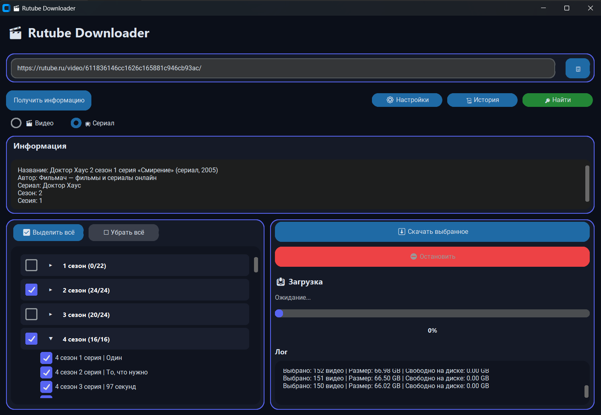

# 🎬 Rutube Downloader

Десктопное приложение на Python для скачивания видео и сериалов с Rutube. Поддерживает выбор отдельных серий и сезонов, сохранение загрузок по папкам и управление загруженными файлами через историю.

<p align="center">
  
</p>

## Возможности

### 📥 Видео и сериалы

- Скачивание отдельных видео с Rutube.
- Поиск сериалов, сезонов и серий.
- Автоматическое определение режима: обычное видео или сериал.
- Отображение названий сериала и отдельных эпизодов.
- Выбор качества загрузки — от 360p до 2160p, если соответствующее качество доступно на Rutube.
- Оценка размера файлов до начала загрузки и проверка свободного места на диске.
- Отображение прогресса, скорости загрузки и текущего файла.
- Остановка загрузки и возможность продолжить её позднее.

### ☑️ Выбор серий по сезонам

Серии отображаются в группах по сезонам. Каждый сезон можно раскрыть или свернуть, не закрывая окно поиска.

- Выбор сезона целиком одним нажатием.
- Возможность выбрать только отдельные серии.
- Счётчик выбранных серий для каждого сезона.
- Кнопки **«Выделить всё»** и **«Убрать всё»** для списка целиком.
- Сворачивание сезона не сбрасывает текущий выбор.

### 📂 Организация файлов

Сериалы автоматически сохраняются в отдельные папки, разбитые по сезонам. Имена файлов включают номера сезона и серии, а также название эпизода, если оно доступно.

Пример структуры:

```text
Видео/
├── Название видео.mp4
└── Название сериала/
    ├── 1 сезон/
    │   ├── 1_1 Название первой серии.mp4
    │   └── 1_2 Название второй серии.mp4
    └── 2 сезон/
        └── 2_1 Название серии.mp4
```

В настройках можно выбрать основную папку загрузки и дополнительную папку для **обычных видео**. Сериалы при этом сохраняют собственную структуру по сезонам.

### 📜 История загрузок

Приложение сохраняет завершённые загрузки в локальной базе SQLite. История включает обычные видео и серии сериалов.

- Сериалы сгруппированы по сезонам: сериал → сезон → эпизоды.
- Для записей сохраняются сведения о видео, ссылке, файле и параметрах загрузки.
- Можно скопировать ссылку на видео или эпизод из истории.
- Можно удалить отдельное видео или серию.
- Можно удалить сезон целиком: приложение удаляет папку сезона и связанные с ним записи истории.
- Можно удалить сериал целиком вместе с его папкой и записями.
- История обновляется без необходимости перезапускать приложение.

История предназначена для управления загрузками, а не только для просмотра списка файлов.

## Установка

### Windows: готовая сборка

1. Откройте [раздел Releases](https://github.com/Kirliffilan/RutubeDownloader/releases/latest).
2. Скачайте архив последнего релиза.
3. Распакуйте архив в удобную папку.
4. Запустите `RutubeDownloader.exe`.

### Запуск из исходников

Понадобится установленный Python и доступ к интернету.

1. Клонируйте репозиторий:

   ```bash
   git clone https://github.com/Kirliffilan/RutubeDownloader.git
   cd RutubeDownloader
   ```

2. Рекомендуется создать виртуальное окружение:

   **Windows:**

   ```powershell
   python -m venv .venv
   .venv\Scripts\Activate.ps1
   ```

   **Linux / macOS:**

   ```bash
   python3 -m venv .venv
   source .venv/bin/activate
   ```

3. Установите зависимости:

   ```bash
   python -m pip install -r requirements.txt
   ```

4. Запустите приложение:

   ```bash
   python main.py
   ```

## Использование

1. Запустите приложение.
2. В настройках укажите папку загрузки, при необходимости — дополнительную папку для обычных видео.
3. Выберите качество и ограничения поиска сезонов и серий.
4. Вставьте ссылку Rutube в поле поиска и нажмите **«Найти»**.
5. Для сериала выберите нужный сезон или отдельные серии. Сезоны можно раскрывать и сворачивать.
6. Нажмите **«Скачать выбранное»**.
7. Следите за прогрессом загрузки. При необходимости используйте кнопку остановки; позднее загрузку можно продолжить.
8. Откройте **«История»**, чтобы посмотреть завершённые загрузки, скопировать ссылку или удалить видео, эпизод, сезон либо сериал.

### Основные элементы управления

| Элемент | Назначение |
|---|---|
| **Найти** | Ищет информацию о видео или сериале по ссылке. |
| **Получить информацию** | Показывает информацию о выбранном видео или сериале без повторного поиска списка серий. |
| **Выделить всё** | Выбирает все найденные серии во всех сезонах. |
| **Убрать всё** | Снимает выбор со всех серий. |
| **Скачать выбранное** | Запускает загрузку отмеченных видео и эпизодов. |
| **Остановить** | Останавливает текущую загрузку. |
| **История** | Открывает список загруженных видео и сериалов и позволяет управлять сохранёнными файлами. |

## Настройки

### Папка загрузки

Основной каталог, в котором хранятся загруженные видео и папки сериалов. По умолчанию используется каталог `Videos/RutubeDownloader` внутри домашней папки пользователя.

### Дополнительная папка для видео

Необязательная настройка для обычных видео. Например, если основной каталог — `D:\Видео`, а дополнительная папка — `Клипы`, файл будет сохранён в `D:\Видео\Клипы`. На структуру папок сериалов эта настройка не влияет.

### Качество

Можно выбрать максимальное доступное качество или конкретный вариант: 2160p, 1440p, 1080p, 720p, 480p либо 360p. Фактически доступные варианты зависят от исходного видео на Rutube.

### Ограничения поиска сериалов

Настройки количества сезонов и серий ограничивают объём данных, получаемых при поиске. Если нужная серия не появилась в списке, проверьте эти значения и увеличьте их при необходимости.

## Где хранятся настройки и история

- Настройки приложения сохраняются в `config.json`.
- История загрузок хранится в локальной базе SQLite.
- Загруженные медиафайлы остаются в выбранной папке сохранения.

Не удаляйте файл базы данных, если хотите сохранить историю загрузок.

## Решение проблем

### Видео или сериал не найден

- Проверьте, правильно ли скопирована ссылка.
- Убедитесь, что видео доступно на Rutube.
- Для сериалов увеличьте ограничения количества сезонов и серий.

### Ошибка загрузки

- Проверьте подключение к интернету и наличие свободного места.
- Убедитесь, что папка загрузки доступна для записи.
- Попробуйте повторить загрузку позднее.

### Ссылка не копируется из истории

Убедитесь, что выбрана запись с доступной ссылкой. Для старых записей ссылка может отсутствовать, если она не была сохранена в базе данных.

### Не удаётся удалить сезон или сериал

Проверьте, что файлы не используются другим приложением и у пользователя есть права на удаление в папке загрузки. Закройте видеоплеер или другое приложение, если оно удерживает файл.

## Технологии

- **Python** — логика приложения.
- **CustomTkinter** — графический интерфейс.
- **yt-dlp** — получение и загрузка медиа.
- **Requests** — HTTP-запросы к Rutube.
- **SQLite** — локальное хранение истории загрузок.
- **Tkinter Treeview** — древовидное отображение истории.

## Структура проекта

```text
RutubeDownloader/
├── .github/
│   └── workflows/            # Автоматизация сборки и другие GitHub Actions
├── assets/                   # Изображения и ресурсы интерфейса
├── ui/                       # Окна и компоненты графического интерфейса
│   ├── confirm_overlay.py    # Диалог подтверждения опасных действий
│   ├── episodes_panel.py     # Список видео и выбор серий по сезонам
│   ├── error_overlay.py      # Отображение ошибок поверх основного окна
│   ├── history_window.py     # История загрузок и управление сохранёнными файлами
│   ├── log_panel.py          # Прогресс загрузки, статус и журнал сообщений
│   ├── main_window.py        # Основное окно и координация действий приложения
│   └── settings_window.py   # Окно настроек приложения
├── config.py                # Чтение, значения по умолчанию и сохранение настроек
├── database.py              # SQLite: история загрузок и операции с записями
├── downloader.py            # Загрузка видео и серий, прогресс и остановка
├── gui.py                   # Создание главного окна приложения
├── main.py                  # Точка входа
├── rutube.py                # Получение информации о видео, сериалах и сериях
├── utils.py                 # Вспомогательные функции, включая оценку размера
├── requirements.txt         # Зависимости Python
├── CHANGELOG.md             # История изменений версий
├── LICENSE                  # Лицензия проекта
├── .gitattributes           # Настройки обработки файлов Git
├── .gitignore               # Исключения Git
└── README.md                # Документация проекта
```

### Компоненты интерфейса

| Файл | Назначение |
|---|---|
| `ui/main_window.py` | Главный экран: поиск, выбор режима, запуск и остановка загрузки, открытие настроек и истории. |
| `ui/episodes_panel.py` | Отображение найденных видео и серий, группировка по сезонам, раскрытие групп и управление выделением. |
| `ui/settings_window.py` | Настройка папок сохранения, качества, максимального числа сезонов и серий. |
| `ui/history_window.py` | Просмотр истории загрузок и действия над сохранёнными файлами. |
| `ui/log_panel.py` | Прогресс, процент выполнения, скорость, оставшееся время и сообщения приложения. |
| `ui/error_overlay.py` | Модальное отображение ошибок. |
| `ui/confirm_overlay.py` | Подтверждение действий, которые могут удалить файлы или записи. |

## Разработка

Для запуска из исходников выполните установку зависимостей и команду `python main.py`. Перед отправкой изменений проверьте синтаксис изменённых файлов и протестируйте обычные видео, выбор серий, историю, а также безопасное удаление файлов.

## Лицензия

Проект распространяется под лицензией [MIT](LICENSE).

При скачивании и использовании материалов соблюдайте применимое законодательство, авторские права и условия использования Rutube.
